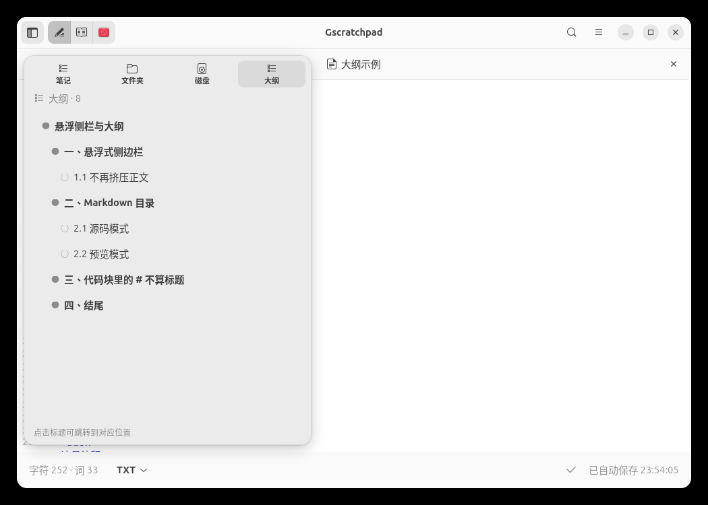
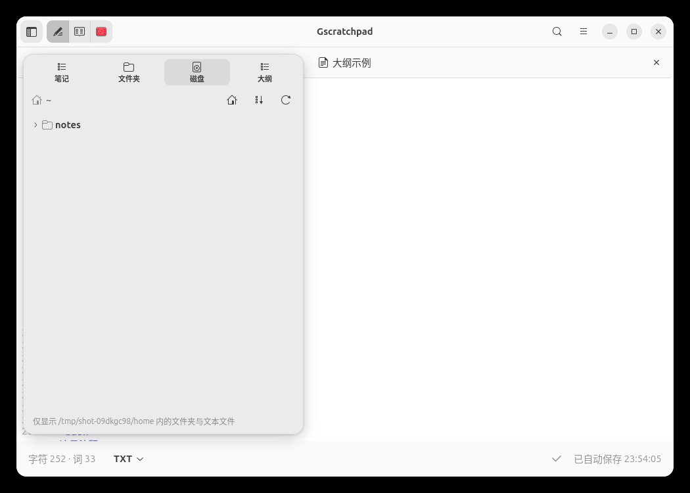
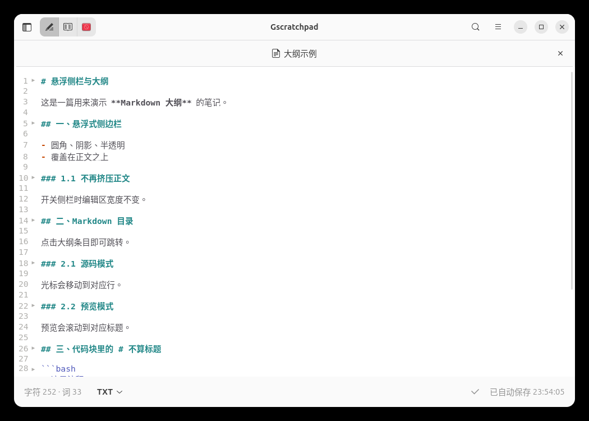
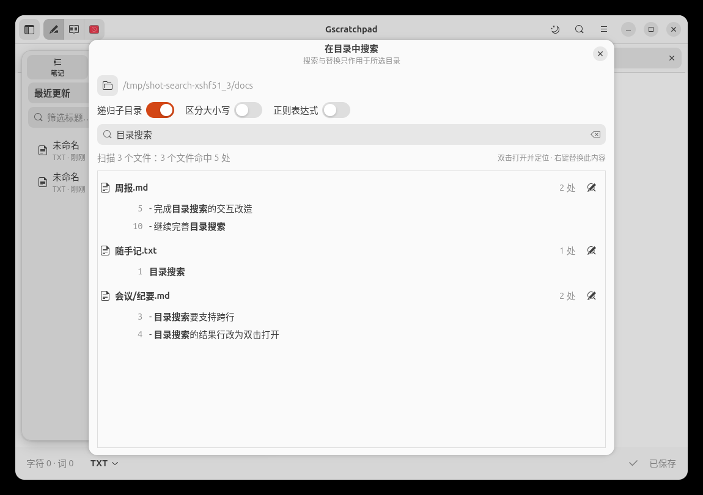
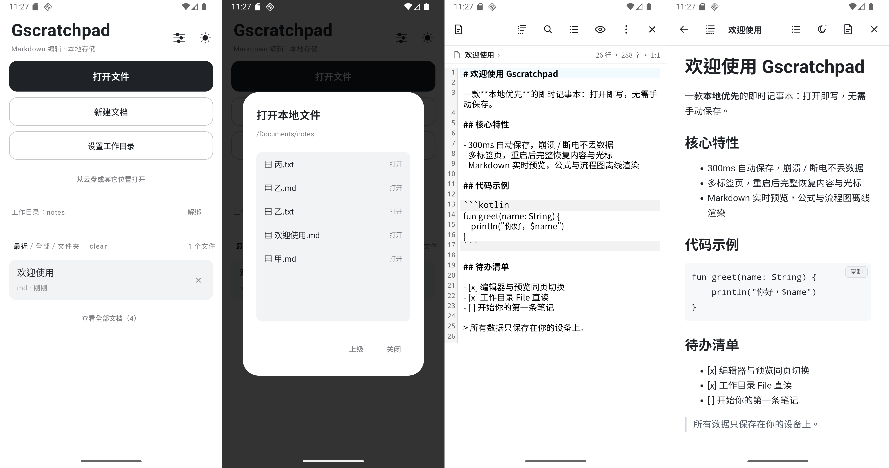

# Gscratchpad

一款**本地优先**的即时记事本：桌面版基于 GTK4 / libadwaita（Python），Android 版为 Kotlin + Compose + CodeMirror 6 原生移植。打开即写，无需手动保存；重启后标签页、正文与光标位置完整恢复；所有数据只保存在你自己的设备上，离线可用。

| 桌面版 | Android 版 |
| --- | --- |
| GTK4 + libadwaita + GtkSourceView 5 + WebKitGTK 6.0（Python） | Kotlin + Compose + WebView（CodeMirror 6，esbuild 单文件内联） |
| DEB 安装，Ubuntu 26.04 LTS | Android 8.0+（APK，arm64-v8a / x86_64） |
| 见 [docs/DESKTOP_GUIDE.md](docs/DESKTOP_GUIDE.md) | 见 [docs/ANDROID_IMPLEMENTATION.md](docs/ANDROID_IMPLEMENTATION.md) |

## 界面预览

**桌面版**






**Android 版**



## 功能亮点

**编辑与持久化**

- 零操作持久化：输入停止 300ms 自动保存，SQLite WAL + 恢复日志保证崩溃/断电安全
- 多标签页 + 编辑进度记忆：重启后完整恢复标签、内容与光标位置
- TXT / Markdown / HTML 多格式、语法高亮、源码折叠（落盘恒为全文）
- 查找替换（正则 / 转义 / 仅选区 / 整批一步撤销）、列编辑、格式化排版、简繁转换

**Markdown 生态**

- 实时预览：KaTeX 公式、Mermaid 流程图本地离线渲染、代码高亮
- PDF 导出：WeasyPrint 真分页，文字矢量可选中可搜索
- 侧边栏四视图：笔记（排序/筛选）、文件夹、磁盘文件树、Markdown 大纲
- 图片相对路径引用，便于与 Markdown 一起移动/版本管理

**效率**

- 目录级搜索与批量替换：递归、编码/BOM/换行保真、执行前自动备份
- 文本片段与触发词展开（`{{cursor}}`、`{{date}}` 等变量，可录制快捷键）
- 命令菜单（Ctrl+K）：全命令搜索执行，显示真实生效的快捷键
- capture v1 接口：D-Bus / CLI 供其它程序把笔记写入本应用（见[手册](docs/DESKTOP_GUIDE.md#供其它程序调用capture-v1)）

**Android 版特性**

- 与桌面版同构的数据模型，桌面备份 zip 可直接导入；镜像级中断恢复，强杀进程后最后一批输入零丢失
- **File 直读工作目录与打开文件**：绑定后「打开文件」浏览器直接落在该目录，「上级」不越界；绕开部分 ROM 的 SAF 视图过滤导致的「看不到文件 / 目录缺失」
- **原子写回**：fsync + 读回校验 + 原子换名，异常中断不留半截文件；SAF 另存用中性 MIME，不会被系统改写后缀
- 编辑器 ↔ 预览同页切换、弹出式文档列表（列出同目录全部文档）、代码块一键复制
- 维护功能与桌面对齐：清除已关闭笔记、清理孤儿文件，提示如实标注「只删应用内记录」
- 存储权限按系统版本分流：Android 11+ 用 MANAGE_EXTERNAL_STORAGE，低版本动态申请 + Android 10 兼容标志；返回键一次退出，不被常驻 WebView 面板拦截
- WebDAV 云备份与恢复、PDF 打印导出、物理键盘快捷键、夜间模式

## 安装

### 桌面版（DEB）

```bash
# 方式一：一键脚本（自动补齐 APT 依赖并安装）
sudo ./scripts/install.sh

# 方式二：手动
sudo apt update
sudo apt install -y python3-gi python3-gi-cairo gir1.2-gtk-4.0 gir1.2-adw-1 \
    gir1.2-gtksource-5 gir1.2-webkit-6.0 gir1.2-javascriptcoregtk-6.0 \
    python3-pygments fonts-noto-cjk
sudo apt install ./dist/gscratchpad_<版本>-1_all.deb
```

从源码构建 DEB：`./packaging/build_deb.sh`（输出到 `dist/`）。卸载：`sudo ./scripts/uninstall.sh`。

### Android 版（APK）

从 Releases 下载对应 ABI 的 `scratchpad-<abi>-release-<版本>.apk`，或自行构建后安装：

```bash
adb install -r android/dist/scratchpad-arm64-v8a-release-<版本>.apk    # 真机（64 位）
adb install -r android/dist/scratchpad-x86_64-release-<版本>.apk      # 模拟器
```

## 构建

### 桌面版（从源码运行）

```bash
./scripts/run-dev.py
# 可选：SCRATCHPAD_DATA_DIR=/tmp/sp-test ./scripts/run-dev.py
```

依赖以 `packaging/build_deb.sh` 中的 `Depends` 为准；`vendor/gir/local/` 内含从 Ubuntu archive 提取的 typelib，未装对应 GIR 包的机器也可直接运行源码。

### Android 版

环境要求：JDK 21、Android SDK（API 36）、Gradle 9.9.1（wrapper）、Node.js（编辑器内核 esbuild 构建）。编辑器内核改动后先重建资产：

```bash
cd android/tools/editor && npm install && node build.mjs && cd ../..
```

```bash
export ANDROID_HOME=<Android SDK 路径>

gradle :app:assembleDebug            # debug 包，仅本地回归
gradle :app:testDebugUnitTest        # JVM 单测（202 条 / 30 套件）
gradle :app:coverageGate             # domain 层行覆盖 ≥80% 门禁
gradle :app:lintRelease              # lint 0 error 门禁
gradle :app:stageRelease             # 一站式发版：R8 + 规范命名 + 包体预算，汇入 android/dist/ 并清旧包
gradle :app:connectedDebugAndroidTest  # 仪器测试（需模拟器或真机）
```

> 本地签名：在 `android/keystore.properties` 配置 upload key（该文件与 `*.jks` 不入库）；缺失时回退 debug 签名。

## 测试

- 桌面版：单元测试 + 真实 GUI 自动化测试（写入/崩溃恢复/自动保存/预览/查找/侧边栏等 20+ 场景），结果见 [docs/TEST_REPORT.md](docs/TEST_REPORT.md)
- Android 版：JVM 单测 202 条 / 30 套件、domain 行覆盖 95.6%、lint 0 error、仪器测试冒烟，门禁任务见 [docs/ANDROID_ENGINEERING.md](docs/ANDROID_ENGINEERING.md) §7

## 文档

| 文档 | 内容 |
| --- | --- |
| [docs/DESKTOP_GUIDE.md](docs/DESKTOP_GUIDE.md) | 桌面版完整手册：功能、快捷键、capture 接口、架构、故障排查 |
| [docs/TEST_REPORT.md](docs/TEST_REPORT.md) | 桌面版测试报告（单元 + GUI 自动化 + 渲染取证） |
| [docs/ANDROID_IMPLEMENTATION.md](docs/ANDROID_IMPLEMENTATION.md) | Android 移植实现说明（数据/编辑器/预览/备份等） |
| [docs/ANDROID_ENGINEERING.md](docs/ANDROID_ENGINEERING.md) | Android 工程化与发布（工具链、门禁、签名、打包纪律） |
| [docs/ANDROID_STAGE_STATUS.md](docs/ANDROID_STAGE_STATUS.md) | Android 阶段进度看板（逐轮变更的唯一权威记录） |
| [docs/ANDROID_FEATURE_MATRIX.md](docs/ANDROID_FEATURE_MATRIX.md) | Android 与桌面版的十项不可移植映射 |
| [docs/ANDROID_OPEN_QUESTIONS.md](docs/ANDROID_OPEN_QUESTIONS.md) | Android 已拍板的设计决策（Q1–Q10） |
| [docs/ANDROID_RISK_REGISTER.md](docs/ANDROID_RISK_REGISTER.md) | Android 风险登记 |
| [docs/ANDROID_SPIKE_REPORT.md](docs/ANDROID_SPIKE_REPORT.md) | Android P0 Spike 验收数据 |
| [docs/archive/](docs/archive/) | 已归档的历史文档（立项书、早期环境记录） |

## License

[MIT](LICENSE)
